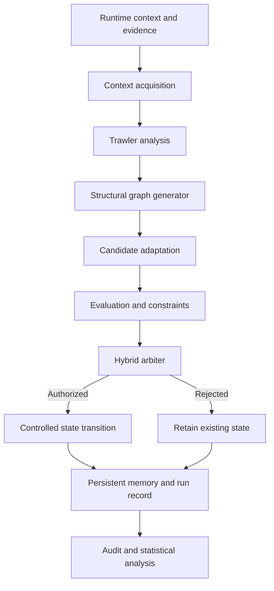
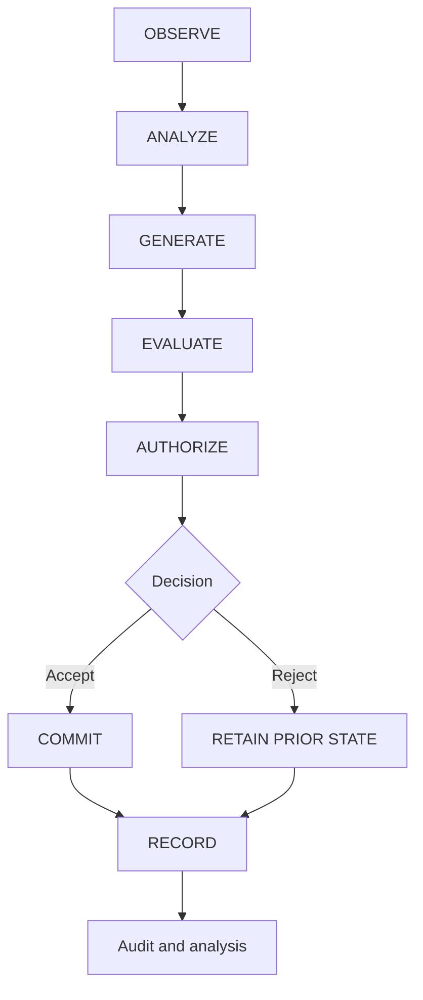
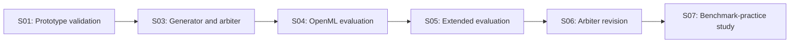
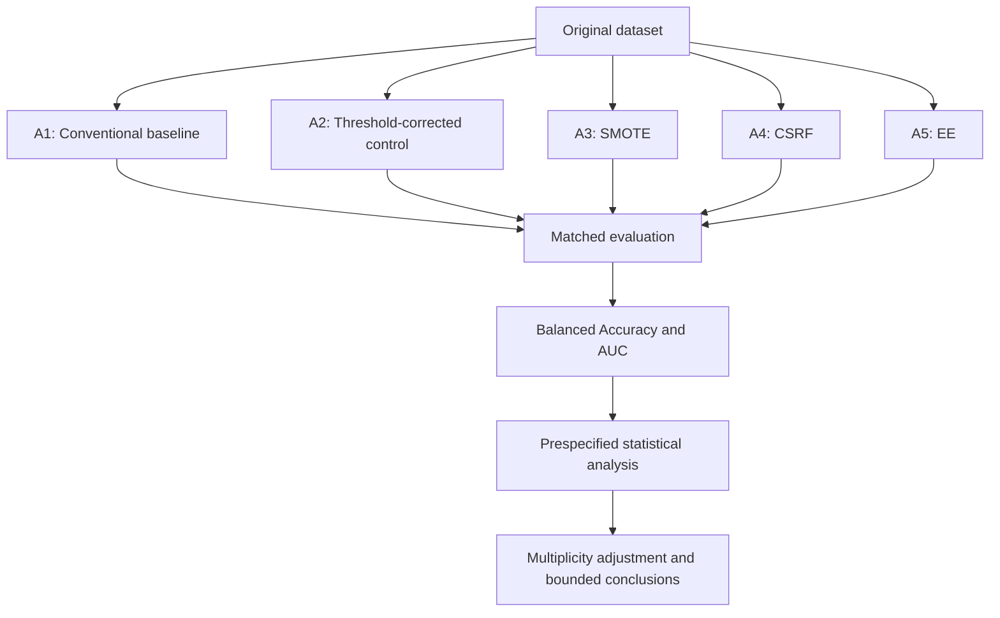

<div align="center">


<br>

<table>
  <tr>
    <td align="center">
      <a href="https://orcid.org/0009-0006-9075-072X">
        
      </a>
    </td>
    <td align="center">
      <a href="https://doi.org/10.5281/zenodo.23252917">
        
      </a>
    </td>
    <td align="center">
      <a href="https://doi.org/10.5281/zenodo.23308347">
        
      </a>
    </td>
  </tr>
  <tr>
    <td align="center">
      <a href="https://doi.org/10.5281/zenodo.23404802">
        
      </a>
    </td>
    <td align="center">
      <a href="https://doi.org/10.5281/zenodo.23406120">
        
      </a>
    </td>
    <td align="center">
      <a href="LICENSE">
        
      </a>
    </td>
  </tr>
</table>

# NeuroCortex SRDF

### Self-Reinforcing Development Framework

**A research framework for controlled, evidence-driven runtime structural adaptation**

**Author:** Mohammed Qaid Al-Athwary  
**Affiliation:** AMAN LIFT YEMEN, Sana’a, Yemen

[Repository](https://github.com/mohammedqaidalathwary/neurocortex-srdf)

</div>
---

## Abstract

NeuroCortex is a research framework built around the Self-Reinforcing Development Framework (SRDF). It investigates controlled runtime structural adaptation through explicit context acquisition, analysis, candidate generation, evaluation, arbitration, and state transitions.

The design separates candidate generation from evaluation and authorization. A generated candidate is not automatically considered beneficial: its acceptance depends on predefined evaluation criteria and system constraints. The framework emphasizes traceable decisions, inspectable execution records, and evidence-bounded claims.

The research program includes prototype validation, generator–arbiter experiments, OpenML-based evaluation, extended evaluation, arbiter revision, and S07, a study of threshold-corrected controls and benchmark-practice bias in imbalanced classification.

This repository is an evolving research program. Each conclusion must be interpreted according to its protocol, cohort, implementation, experimental unit, and recorded results. The studies do not by themselves establish general intelligence or universal self-improvement.

## Contents

1. [Research Overview](#research-overview)
2. [Architecture](#architecture)
3. [Adaptation Workflow](#adaptation-workflow)
4. [Research Program](#research-program)
5. [S07 Study](#s07-study)
6. [S07 Reported Results](#s07-reported-results)
7. [Repository Organization](#repository-organization)
8. [Reproducibility](#reproducibility)
9. [Claim Boundaries](#claim-boundaries)
10. [Citation](#citation)
11. [License](#license)

## Research Overview

Machine-learning systems are commonly developed through externally designed experiments and manually selected configurations. SRDF investigates a structured process in which a system identifies a runtime condition, proposes a candidate adaptation, evaluates it, and authorizes or rejects a controlled transition.

The central research question is not merely whether a system can generate a modification. It is whether the modification can be evaluated under explicit criteria, whether the decision can be traced to evidence, and whether the resulting transition remains subject to defined constraints.

### Research questions

| Area | Question | Evidence needed |
|---|---|---|
| Controlled adaptation | Can candidates be evaluated before commitment? | Execution records and decision outcomes |
| Generator–arbiter separation | Can generation be separated from authorization? | Component tests and arbitration records |
| Generalization | How does behavior vary across datasets? | Defined cohorts and appropriate statistical analysis |
| Decision criteria | How sensitive are decisions to metrics and thresholds? | Controlled comparisons and sensitivity analyses |
| Benchmark methodology | Can baseline thresholds change apparent advantages? | Matched comparisons and prespecified tests |
| Reproducibility | Can others inspect how results were produced? | Versioned protocols, code, and result artifacts |

## Architecture

The following diagram summarizes the conceptual responsibilities. It does not imply that every experiment activates every component identically.



| Component | Conceptual responsibility |
|---|---|
| Context Acquisition | Collects information about the current state or task. |
| Trawler Analysis | Analyzes context and identifies conditions relevant to adaptation. |
| Structural Graph Generator | Proposes candidate structural changes. |
| Evaluation | Assesses candidates using the applicable protocol. |
| Hybrid Arbiter | Applies the defined authorization policy. |
| Persistent Memory | Supports retention of relevant state or records. |
| Resource Manager | Accounts for computational constraints. |
| Run Record | Preserves information needed to inspect execution and outcomes. |

## Adaptation Workflow



The intended evidence chain is **Evidence → Protocol → Execution → Statistics → Claims**. Confirmatory procedures should be defined before interpreting the results. Changes to a locked protocol should be documented rather than silently incorporated into the original analysis.

A rejection, an absent trigger, or an empty generator output is not automatically a system failure. Valid negative decisions should be distinguished from incomplete execution, infrastructure interruptions, data errors, dependency failures, and experiment-harness failures.

## Research Program



### S01 — Prototype validation

The prototype stage investigates basic framework behavior in a controlled illustrative setting. Its results apply to that setting and do not independently establish broad empirical generalization.

### S03 — Generator and arbiter

This stage investigates interactions between candidate generation and decision-making, including conditions under which candidates are evaluated, accepted, or rejected.

### S04 — OpenML evaluation

The committed S04/R4 run used a frozen cohort of **45 datasets**, evaluated with **5 random seeds** and **5 stratified folds per seed**. The planned and recorded total was **1125 fold-level cases**. These cases are repeated observations within datasets and must not be treated as independent datasets.

The committed run summary records the following terminal outcomes:

| Outcome | Cases | Share of all planned cases |
|---|---:|---:|
| `SUCCESS` | 373 | 33.16% |
| `NOT_TRIGGERED` | 750 | 66.67% |
| `REJECTED` | 2 | 0.18% |
| **Total** | **1125** | **100.00%** |

A trigger occurred in **375 cases** (33.33% of planned cases). Of these, **373** ended in successful adaptation and **2** were rejected. The summary records **0 failure cases**. `NOT_TRIGGERED` cases are not assigned a zero performance change.

Among the **373 successful cases with valid performance differences**, the recorded mean change in Balanced Accuracy relative to the conventional baseline was **+0.028855** (case-level standard deviation 0.048463). These are fold-level observations, not independent dataset-level replicates.

At the dataset level, the recorded summary contains **15 datasets with successful adaptation contributing to the dataset-level comparison**. Their mean Balanced Accuracy change was **+0.028805**, with a dataset-level bootstrap 95% confidence interval of **[+0.014811, +0.044278]**. This dataset-level result is based on the datasets represented in that analysis, not all 45 cohort members.

These are observed results under the committed S04 protocol. They do **not** by themselves establish universal superiority, broad self-improvement, or general intelligence.

#### S04 evidence and reproducibility boundary

The committed cohort-closure report records an exact reconstruction of the 45-dataset selection from the frozen metadata snapshot, with zero symmetric difference. The closure audit also states two limitations: it did not make live OpenML queries, and the original S04 selection notebook used as the reconstruction reference is not stored in this repository. Therefore, cohort-artifact integrity and reconstruction are documented, but a fully independent end-to-end reproduction from every original execution input is not established by the repository alone.

The authoritative committed artifacts are:

- Protocol: `experiments/S04_OPENML_GENERALIZATION/protocol/R4_PROTOCOL.json`
- Run summary: `experiments/S04_OPENML_GENERALIZATION/statistics/r4_summary.json`
- Cohort closure audit: `experiments/_AUDIT/S04_CLOSURE_REPORT.json`
### S05 — Extended evaluation

S05 extends the empirical program. Its exact cohort, implementation, protocol, and conclusions should be taken from its own versioned artifacts rather than inferred from another phase.

### S06 — Arbiter revision

S06 investigates a revised arbitration configuration. Comparisons between S04 and S06 should preserve the definitions of their respective protocols and distinguish raw performance differences from differences caused by thresholds, baselines, or evaluation choices.

## S07 Study

### Study title

**Does Class-Imbalance Correction Beat a Threshold-Corrected Control? A Catalog-Wide Confirmatory Study of Benchmark-Practice Bias.**

S07 investigates whether the apparent benefit of imbalance-correction methods changes when the comparison uses a threshold-corrected control rather than relying only on a conventional baseline.

### Conceptual comparison



The diagram illustrates the comparison concept. The frozen S07 protocol is authoritative for the exact definitions of A1–A5, preprocessing, thresholds, exclusions, metrics, and tests.

### Protocol and result records

- **Protocol DOI:** [10.5281/zenodo.23404802](https://doi.org/10.5281/zenodo.23404802)
- **Results DOI:** [10.5281/zenodo.23406120](https://doi.org/10.5281/zenodo.23406120)
- **Locked protocol SHA-256:** `c78b78ed48ea3e00d1e1c9f63ace246485fff8657164061aded5fdeb8febd525`
- **Experiment directory:** `experiments/S07_PRACTICE_INFLATION/`
- **Recorded notebook path:** `S07-pipeline_integrity.ipynb`

The cohort record identifies 131 candidate datasets and 98 analyzed datasets. The candidate cohort and analyzed cohort are distinct and should not be conflated.

## S07 Reported Results

The table below transcribes the available reported summary. It is not a substitute for the original results or an independent reanalysis.

| Comparison | Metric | n | Mean difference | Raw p | Holm-adjusted p | Reported status |
|---|---|---:|---:|---:|---:|---|
| H1: A2 − A1 | Balanced Accuracy | 98 | +0.09764693 | 0.00001 | 0.00007 | SUPPORTED |
| H2_SMOTE: A3 − A2 | Balanced Accuracy | 40 | −0.03650658 | 0.99016 | 1.00000 | INFERIOR |
| H2_CSRF: A4 − A2 | Balanced Accuracy | 98 | −0.10714144 | 1.00000 | 1.00000 | INFERIOR |
| H2_EE: A5 − A2 | Balanced Accuracy | 98 | +0.00739482 | 0.00001 | 0.00007 | EQUIVALENT |
| H4_SMOTE: A3 − A1 | AUC | 40 | −0.00594658 | 0.00428 | 0.01284 | EQUIVALENT |
| H4_CSRF: A4 − A1 | AUC | 98 | −0.00284367 | 0.00001 | 0.00007 | EQUIVALENT |
| H4_EE: A5 − A1 | AUC | 98 | +0.00121313 | 0.00001 | 0.00007 | EQUIVALENT |

**Interpretation note:** These are the statuses recorded in the reported summary. Equivalence is a margin-dependent conclusion and cannot be established solely by a small observed difference or a particular p-value. The prespecified margins, test direction, and test implementation must be checked in the locked protocol and analysis artifacts.

The A1–A2 comparison evaluates the effect of threshold correction on the baseline under the study procedure. Comparisons between A2 and the correction arms examine whether those methods provide an additional benefit beyond the threshold-corrected control. AUC provides a complementary ranking-oriented measure, distinct from threshold-dependent measures.

The findings concern the methods, datasets, metrics, and analysis used in S07. They do not automatically generalize to every classifier, dataset, resampling method, or evaluation protocol, and they do not establish overall superiority or inferiority of NeuroCortex SRDF.

## Repository Organization

```text
neurocortex-srdf/
├── README.md
├── CITATION.cff
├── CHANGELOG.md
├── CONTRIBUTING.md
├── CODE_OF_CONDUCT.md
├── SECURITY.md
├── LICENSE
├── pyproject.toml
├── requirements.txt
├── src/
├── src_v2/
├── src_v3/
├── src_v4/
├── tests/
├── examples/
│   ├── srdf_toy_english/
├── docs/
├── assets/
└── experiments/
    ├── S01_PROTOTYPE_VALIDATION/
    ├── S03_GENERATOR_ARBITER/
    ├── S04_OPENML_GENERALIZATION/
    ├── S05_EXTENDED_EVALUATION/
    ├── S06_ARBITER_REVISION/
    ├── S07_PRACTICE_INFLATION/
    └── _AUDIT/
```

This is a navigational overview, not a guaranteed exhaustive filesystem listing. The current GitHub branch is authoritative for actual filenames and paths.

| Artifact | Purpose |
|---|---|
| `src/` and versioned source directories | Framework implementation and development iterations |
| `tests/` | Automated tests and checks |
| `examples/` | Illustrative examples |
| `docs/` | Supporting documentation |
| `assets/` | Project assets |
| `experiments/` | Versioned empirical studies and supporting artifacts |
| `CITATION.cff` | Citation metadata, when maintained |
| `CHANGELOG.md` | Recorded project changes |
| `LICENSE` | Licensing terms |
| `pyproject.toml` and `requirements.txt` | Project and dependency configuration |

Use the source version and configuration associated with the experiment being reproduced. The latest implementation is not necessarily identical to the implementation used for an earlier result.

## Installation and Environment

Clone the repository:

```bash
git clone https://github.com/mohammedqaidalathwary/neurocortex-srdf.git
cd neurocortex-srdf
```

Review `pyproject.toml` and `requirements.txt` before installing dependencies. If the project configuration supports editable installation, a typical command is:

```bash
python -m pip install -e .
```

For reproducible work, record the Python version, dependency versions, operating environment, random seeds, dataset identifiers, preprocessing configuration, source revision, and protocol version. A successful installation does not guarantee that every historical notebook runs unchanged in the same environment.

## Examples and Tests

Inspect the current example files:

```bash
find examples -maxdepth 3 -type f
```

Inspect test files:

```bash
find tests -maxdepth 3 -type f
```

If the project uses pytest and the necessary dependencies are installed, run:

```bash
python -m pytest
```

Adjust the command if the repository defines a different test runner or requires specific configuration. Passing software tests supports the behaviors actually tested; it does not independently establish scientific validity or generalization.

## Reproducibility

A reproducible experiment requires more than a final metric. A run record should include, where applicable:

- Unique run identifier and timestamp.
- Source revision, implementation version, and protocol identifier/hash.
- Dataset identifiers and cohort-selection procedure.
- Random seed and fold assignment.
- Preprocessing and model configuration.
- Candidate generation, evaluation, and arbitration outcomes.
- Metric values and the statistical unit of analysis.
- Exclusions and their prespecified reasons.
- Execution status and failure category.
- Statistical tests, multiplicity correction, and uncertainty estimates.

### Evidence chain

1. **Implementation evidence:** source code, tests, and component behavior.
2. **Execution evidence:** records of what ran and what happened.
3. **Protocol evidence:** predefined procedures, parameters, criteria, and exclusions.
4. **Statistical evidence:** results calculated using the specified analysis.
5. **Scientific claims:** interpretations supported by the preceding evidence.

A claim should not be stronger than its supporting evidence. Exploratory analyses are valuable for discovery, but should be identified as exploratory when they were not covered by the locked confirmatory procedure.

### Statistical units

Multiple folds from one dataset are not automatically independent datasets. Multiple runs on the same dataset may share sources of variation. Reports should identify the statistical unit and account for dependence where required by the design.

### Auditability

An audit check marked PASS should correspond to a defined check and a recorded outcome. The existence of an audit report does not remove the need to inspect what was tested and what remains outside the audit scope.

## Computational Context

The project has been developed under constrained computational conditions, including free cloud notebook resources. This context helps describe the practical conditions under which experiments were conducted.

Resource constraints can affect runtime, throughput, continuity, and the feasibility of repeated experiments. They neither prove nor disprove a scientific claim. Interrupted runs, resource exhaustion, dependency failures, and incomplete experiments should be recorded rather than silently treated as completed observations.

## Claim Boundaries

NeuroCortex is an evolving research framework. Its software architecture and empirical findings should be assessed separately.

Claims about controlled adaptation require implementation and execution records. Claims about generalization require defined datasets, evaluation procedures, and appropriate statistical analysis. Claims about superiority require fair comparisons against clearly specified baselines under comparable conditions.

The current research program investigates:

- Explicitly mediated runtime adaptation.
- Separation of generation, evaluation, arbitration, and commitment.
- Traceable execution and decision records.
- Empirical behavior across defined machine-learning benchmarks.
- Sensitivity of benchmark conclusions to thresholds and comparison methods.
- Reproducibility and protocol-based research practice.

The available evidence should not be interpreted as proof that every adaptation improves performance, that the framework outperforms every alternative, that fold-level observations are independent datasets, or that the project has demonstrated general intelligence or universal self-improvement.

These boundaries clarify what each experiment can legitimately establish; they do not negate the value of a well-designed and reproducible experiment.

## Citation

Use the DOI and version corresponding to the specific code, protocol, or results being cited.

- **Project archive:** https://doi.org/10.5281/zenodo.23252917
- **S06 protocol:** https://doi.org/10.5281/zenodo.23308347
- **S07 preregistration:** https://doi.org/10.5281/zenodo.23404802
- **S07 results:** https://doi.org/10.5281/zenodo.23406120
- **Repository:** https://github.com/mohammedqaidalathwary/neurocortex-srdf

Consult `CITATION.cff` and the archived records for canonical bibliographic metadata. A repository citation, protocol citation, and results citation identify different research artifacts.

## License

Consult the repository `LICENSE` file for the authoritative licensing terms. The license badge identifies the repository as Apache-2.0; the license file governs. Third-party datasets, libraries, and external assets may have separate terms.

## Contributions and Contact

Technical feedback, reproducibility reports, issue reports, and scientifically grounded criticism are welcome. Include the relevant source revision, experiment identifier, environment, command, and a minimal reproduction where possible.

For empirical discrepancies, identify the protocol version and exact result artifact being compared. Distinguish verified behavior from assumptions, exploratory findings from confirmatory results, and environmental failures from protocol deviations.

**Author:** Mohammed Qaid Al-Athwary  
**ORCID:** https://orcid.org/0009-0006-9075-072X  
**Repository:** https://github.com/mohammedqaidalathwary/neurocortex-srdf

---

<div align="center">
**NeuroCortex SRDF**  
*Controlled adaptation. Traceable decisions. Evidence-bounded claims.*
</div>


## Phase 1c Disclosures (Added 2026-10-29)

As part of my continuous integrity audit, I have added explicit disclosures for historical design choices:
- **S06 Adaptive Design:** `experiments/S06_ARBITER_REVISION/ADAPTIVE_DESIGN_DISCLOSURE.md`
- **S07 Source-Level Deduplication:** `experiments/S07_PRACTICE_INFLATION/SOURCE_LEVEL_ANALYSIS.md`
- **S07 Execution Timing:** `experiments/S07_PRACTICE_INFLATION/TIMING_DISCLOSURE.md`
- **S07 English Summary:** `experiments/S07_PRACTICE_INFLATION/S07_REPORT_ENGLISH_SUMMARY.md`

